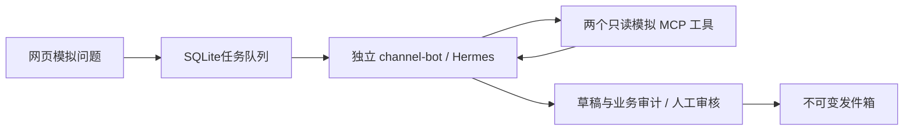

# 渠道智能体本机联调

2026-10-26：完成 Mac 后端模拟数据链路。原安卓固定回执代码未改，本目录尚未部署到手机。



## 本机使用

在 `backend` 目录运行：

```sh
uv sync --frozen
.venv/bin/python manage.py start
.venv/bin/python manage.py open
.venv/bin/python manage.py status
# 结束本轮联调
.venv/bin/python manage.py stop
```

审核页为 `http://127.0.0.1:8660/`。`open` 会打开浏览器并完成本机凭证传递；直接访问时，凭证在 `.local/reviewer-key.txt`，不要分享或提交。页面立即清除 URL 片段，只在该标签会话保存凭证。此为单审核人本机工具，尚不具备正式多人账号管理。

所有服务仅监听本机回环。Hermes 为8643，模拟MCP为8650，中间层为8660。网页创建的任务属于 `web-demo`，不会向手机凭证开放领取；“通过”只创建模拟发件记录。要处理新的问题需保持 Mac 和三个服务运行。未创建开机自启动服务。

样例：

- `订单 A123 卡在哪一步，需要补什么？`：资料审核／待补营业执照扫描件。
- `订单 A124 是什么状态？`：已完成。
- `查询 B999`：属于其他渠道，工具不返回业务内容，转人工。
- `查询 Z000`：不存在，与无权限使用同一错误。
- `查询 A500`、`查询 A408`：模拟工具失败／超时错误，转人工。A408是错误样本，真实等待超时另有适配器测试。

审核时核对问题、业务依据和草稿，可修改后通过或驳回。未审核、缺少工具依据、工具失败、过期及运行状态不明的任务不能自动入箱。审批后版本不可覆盖；发件结果不确定也不自动重投。首轮不实现撤销重审或自动重试 `not_sent`，需人工核查。

## 初次安装（其他机器）

1. 安装并固定 Hermes v0.22.5，本轮实测提交 `bf0203a794a0`。
2. 在默认 Hermes 配置中配置 DeepSeek；当前初始化脚本只支持复用 `DEEPSEEK_API_KEY` 和该模型设置。
3. 执行 `hermes profile create channel-bot --no-skills --no-alias`。
4. `uv sync --frozen` 后执行 `.venv/bin/python configure.py`；已有配置时拒绝覆盖或自动换密钥。
5. `manage.py start` 启动服务后，运行 `.venv/bin/python -m scripts.verify_profile`。未完成实际工具核验或配置指纹变化时，工作进程等待检查，不提交任务。

仅复制 DeepSeek 凭证，不复制个人历史、其他平台令牌或个人技能。运行记录和密钥在 `.local/`，Hermes 配置在专用 profile；两者均不提交 Git。

## 固定版本的实际差异

本轮直接验过，不依赖网页描述推断：

- v0.22.5 默认单主网关。为了不启用个人配置里的连接，本机 profile 使用官方临时兼容项 `gateway.standalone: true`。未来上服务器需重新确认受支持的独立部署方式；不能只照搬旧启动命令。
- `GET /v1/toolsets` 实测遗漏 MCP 工具集，不能单独作为白名单证明。`verify_profile` 使用官方安装绑定的 Python 环境解析实际工具定义，确认仅有 `mcp__biz__query_order`、`mcp__biz__query_trace`。工作进程还检查配置指纹与无额外内置工具。
- `--no-skills` 仍保留官方不可禁用的 `hermes-agent` 操作手册。没有个人技能，也未开放技能读取、文件或终端工具。自动工具检索桥接已关闭，避免额外的 `tool_describe` 等工具出现。
- `GET /v1/skills` 在本版本实测返回500（上游参数不匹配）。技能核验改用同版本运行时，不修改官方源码。
- 实测 SSE 的 `tool.completed.preview` 为空。中间层保存 SSE，同时在运行结束后读取该独立会话的工具消息，将 `tool_call_id`、工具名、参数、返回的 `audit_id` 与本渠道业务审计核对。未找到唯一依据就转人工；不从模型草稿猜审计编号，也不向审核页保存/展示模型推理文本。
- Runs 幂等支持24小时持久化保留。中间层先保存不可变请求，提交结果不明时仅在5分钟内用原键/原正文最多重试3次；超过窗口转人工。已有 `run_id` 只查询原运行。

## 代码与数据

- `channel_backend/store.py`：SQLite事务、设备事件去重、审核和发件箱。
- `channel_backend/agent.py`：持久化任务恢复、Runs轮询与事件、证据关联、超时停止。
- `channel_backend/business.py`、`mcp_server.py`：两个只读模拟工具。授权渠道由服务端凭证绑定；不存在和越权不返回业务字段。
- `channel_backend/server.py`、`static/`：本机审核页面、审核和设备分权接口、跨站与Host检查。
- `configure.py`、`manage.py`：专用配置初始化、服务启停、审核页打开。
- `scripts/verify_profile.py`：实际工具/技能核验；需要同机 Hermes 官方源码安装。
- `scripts/smoke.py`：**会调用模型**的三条模拟链路验收，包含自动验收用审批；不会发送微信。
- `.local/tasks.sqlite3`：任务、事件、审核、发件箱；`.local/audit.sqlite3`：业务依据。原始运行记录只留本机，正式部署需增加备份和保留策略。

接口：设备 `POST /api/messages`、`GET /api/outbox`、`POST /api/outbox/{id}/{claim,sending,ack}`；审核 `GET /api/review/tasks`、`POST /api/review/{task_id}`。设备与审核凭证不同。群映射固定测试1，暂不支持多设备、多群、真实微信成员身份或跨问题上下文。投递 `sending` 即使领取超时也不自动回收；必须核查同一次发送尝试结果。

## 验证

```sh
.venv/bin/python -m unittest discover -s tests -v
node --check channel_backend/static/app.js
.venv/bin/python -m scripts.verify_profile
# 显式模型联调，使用模拟数据并产生少量模型用量
.venv/bin/python -m scripts.smoke
```

本轮结果与边界见 [VALIDATION.md](VALIDATION.md)。下一阶段才修改手机：持久化问题队列、通过受保护网络上报、答案领取、界面串行收发与结果回报。首轮保持原群文字答案，真正 @ 提问人和连续追问单独验收。
