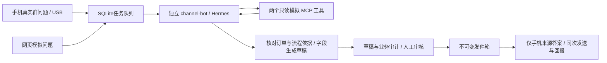

# 渠道智能体本机联调

整体架构、接口与能力边界见 [技术方案](../docs/技术方案.md)；公司服务器由部署人员按 [ECS 部署交接](../deploy/README.md) 自行操作。本文的 `manage.py` 命令用于本机开发联调，不作为 ECS 现有 Hermes 的启停方式。

2026-10-28：小米HTTP桥接继续使用本Mac、USB连接和模拟数据。新增摘要截断适配、订单依据结构化返回与字段校验，原固定回执模式保留。



## 本机使用

在 `backend` 目录运行：

```sh
uv sync --frozen
.venv/bin/python manage.py start
.venv/bin/python manage.py open
.venv/bin/python manage.py status
# 结束本轮联调
.venv/bin/python manage.py stop
```

审核页为 `http://127.0.0.1:8660/`。`open` 会打开浏览器并完成本机凭证传递；直接访问时，凭证在 `.local/reviewer-key.txt`，不要分享或提交。页面立即清除 URL 片段，只在该标签会话保存凭证。此为单审核人本机工具，尚不具备正式多人账号管理。

所有服务仅监听本机回环。Hermes 为8643，模拟MCP为8650，中间层为8660。网页创建的任务属于 `web-demo`，不会向手机凭证开放领取；网页来源“通过”只创建模拟发件记录；手机来源“通过”会由正在运行的手机领取并向测试1发送。页面区分两种来源。要处理新的问题需保持 Mac 和三个服务运行。未创建开机自启动服务。

样例：

- `订单 A123 卡在哪一步，需要补什么？`：资料审核／待补营业执照扫描件。
- `订单 A124 是什么状态？`：已完成。
- `查询 B999`：属于其他渠道，工具不返回业务内容，转人工。
- `查询 Z000`：不存在，与无权限使用同一错误。
- `查询 A500`、`查询 A408`：模拟工具失败／超时错误，转人工。A408是错误样本，真实等待超时另有适配器测试。

审核时核对问题、业务依据和草稿，可修改后通过或驳回。未审核、缺少工具依据、工具失败、过期及运行状态不明的任务不能自动入箱。审批后版本不可覆盖；发件结果不确定也不自动重投。首轮不实现撤销重审或自动重试 `not_sent`，需人工核查。

## 列表审核工作台（2026-10-28）

- **答案审核**：按全部、待审核、生成中、已审核、需关注切换。关键词可查问题、提问人及编号，还可组合来源、群聊、时间范围筛选；统计随筛选条件更新。
- **后台分页**：每页 10 / 20 / 50 条，支持最新或最早在前，历史记录不受旧接口最近 100 条限制。列表不加载完整工具审计，打开详情时才读取。
- **右侧详情**：展示完整问题、可读的订单/流程依据、原始审计记录和草稿。修改内容在本页内保留，刷新列表、关闭再打开详情不会丢失；重新加载整个页面会清空未提交的修改。
- **发件记录**：展示审核确定版本和发送状态；“已观察到发出”表示手机观察到发送气泡，不代表对方已读。网页模拟始终单独标注。
- 草稿超过 30 分钟列入“需关注”，详情只读；过期发件项也标为已过期。上述为只读展示，不修改历史状态或触发重发。仍逐条人工审核。
- “模拟提问”移到右上角弹窗；登录和已有审核凭证方式保持一致。自动更新间隔为 5 秒，详情编辑内容不会被轮询覆盖。

新增审核只读接口：`GET /api/review/list` 与 `GET /api/review/task/{task_id}`。列表参数为 `view=tasks|outbox`、`category`、`source=all|phone|web-demo`、`group`、`q`、`since`（Unix 秒）、`sort=newest|oldest`、`page`、`page_size=10|20|50`。它们使用审核凭证；设备 API 不变。旧 `/api/review/tasks` 为兼容诊断脚本保留。

独立浏览器回归（临时数据库、无 Hermes 任务、无手机投递）：

```sh
# 终端一，按 Ctrl-C 关闭并清理临时数据库
.venv/bin/python -m tests.review_ui_fixture
# 终端二，需要已有 Playwright 和 Chrome；不依赖本机联调凭证
node scripts/review_ui_smoke.mjs
# 可用 PLAYWRIGHT_MODULE 指定已有 Playwright index.mjs，CHROME_PATH 指定浏览器
```

测试服务仅监听 `127.0.0.1:8661`。浏览器脚本固定访问该端口和临时测试凭证，截图及结果写入已忽略的 `.local/review-ui/`。无需把浏览器测试数据写入当前业务数据库。

## ECS 办公网试点准备

已加入可配置 HTTPS 域名、Host/Origin 校验、设备配置导出和手机后台队列隔离。目标为 Ubuntu 22.04.5 宿主机部署，沿用宿主机 Hermes 和公司已有的订单/代码工具或 MCP，新增 live 模式经本机 8650 白名单审计网关转发公司工具，mock 模式仍保留。真实工具契约和权限需在目标环境验收；见 [正式接入交接](../deploy/README.md)。现有模拟环境操作另见 [模拟联调部署参考](../deploy/模拟联调部署.md)。未部署到 ECS，手机仍使用 Mac USB 模式。

## 初次安装（其他机器）

1. 安装并固定 Hermes v0.22.5，本轮实测提交 `bf0203a794a0`。
2. 在默认 Hermes 配置中配置 DeepSeek；当前初始化脚本只支持复用 `DEEPSEEK_API_KEY` 和该模型设置。
3. 执行 `hermes profile create channel-bot --no-skills --no-alias`。
4. `uv sync --frozen` 后执行 `.venv/bin/python configure.py`；已有配置时拒绝覆盖或自动换密钥。
5. `manage.py start` 启动服务后，运行 `.venv/bin/python -m scripts.verify_profile`。未完成实际工具核验或配置指纹变化时，工作进程等待检查，不提交任务。

仅复制 DeepSeek 凭证，不复制个人历史、其他平台令牌或个人技能。运行记录和密钥在 `.local/`，Hermes 配置在专用 profile；两者均不提交 Git。

## 固定版本的实际差异

本轮直接验过，不依赖网页描述推断：

- v0.22.5 默认单主网关。为了不启用个人配置里的连接，本机 profile 使用官方临时兼容项 `gateway.standalone: true`。未来上服务器需重新确认受支持的独立部署方式；不能只照搬旧启动命令。
- `GET /v1/toolsets` 实测遗漏 MCP 工具集，不能单独作为白名单证明。`verify_profile` 使用官方安装绑定的 Python 环境解析实际工具定义，确认仅有 `mcp__biz__query_order`、`mcp__biz__query_trace`。工作进程还检查配置指纹与无额外内置工具。
- `--no-skills` 仍保留官方不可禁用的 `hermes-agent` 操作手册。没有个人技能，也未开放技能读取、文件或终端工具。自动工具检索桥接已关闭，避免额外的 `tool_describe` 等工具出现。
- `GET /v1/skills` 在本版本实测返回500（上游参数不匹配）。技能核验改用同版本运行时，不修改官方源码。
- 实测 SSE 的 `tool.completed.preview` 为空。中间层保存 SSE，同时在运行结束后读取该独立会话的工具消息，将 `tool_call_id`、工具名、参数、返回的 `audit_id` 与本渠道业务审计核对。未找到唯一依据就转人工；不从模型草稿猜审计编号，也不向审核页保存/展示模型推理文本。
- Runs 幂等支持24小时持久化保留。中间层先保存不可变请求，提交结果不明时仅在5分钟内用原键/原正文最多重试3次；超过窗口转人工。已有 `run_id` 只查询原运行。

## 代码与数据

- `channel_backend/store.py`：SQLite事务、设备事件去重、审核和发件箱。
- `channel_backend/grounding.py`：单订单结构化依据校验和字段草稿生成；模型额外自由说明、错误依据或矛盾数据转人工。
- `channel_backend/agent.py`：持久化任务恢复、Runs轮询与事件、证据关联、超时停止。
- `channel_backend/business.py`、`mcp_server.py`：两个只读模拟工具。授权渠道由服务端凭证绑定；不存在和越权不返回业务字段。
- `channel_backend/review_query.py`：审核列表的只读搜索、分类统计与分页。
- `channel_backend/server.py`、`static/`：本机审核页面、审核和设备分权接口、跨站与Host检查。
- `configure.py`、`manage.py`：专用配置初始化、服务启停、审核页打开。
- `scripts/verify_profile.py`：实际工具/技能核验；需要同机 Hermes 官方源码安装。
- `scripts/smoke.py`：**会调用模型**的三条模拟链路验收，包含自动验收用审批；不会发送微信。
- `.local/tasks.sqlite3`：任务、事件、审核、发件箱；`.local/audit.sqlite3`：业务依据。原始运行记录只留本机，正式部署需增加备份和保留策略。

接口：设备 `POST /api/messages`、`GET /api/outbox`、`POST /api/outbox/{id}/{claim,sending,ack}`；审核 `GET /api/review/tasks`、`POST /api/review/{task_id}`。设备与审核凭证不同。群映射固定测试1，暂不支持多设备、多群、真实微信成员身份或跨问题上下文。投递 `sending` 即使领取超时也不自动回收；必须核查同一次发送尝试结果。

## 验证

```sh
.venv/bin/python -m unittest discover -s tests -v
node --check channel_backend/static/app.js
.venv/bin/python -m scripts.verify_profile
# 显式模型联调，使用模拟数据并产生少量模型用量
.venv/bin/python -m scripts.smoke
```

本轮结果与边界见 [VALIDATION.md](VALIDATION.md)。手机桥接见仓库根目录的 `agent-bridge.js`、`agent-client.js` 和监听脚本。首轮保持原群文字答案，真正 @ 提问人和连续追问单独验收。

## 小米USB联调

确认手机机器人已停止、STOP存在、没有watch.lock，微信已登录测试账号且测试1旧消息已读。以下命令在backend目录执行：

```sh
.venv/bin/python manage.py start
.venv/bin/python -m scripts.provision_phone --serial YOUR_DEVICE_SERIAL
.venv/bin/python manage.py open
```

部署脚本会先保留旧脚本/状态到本机checkpoints，设置 `adb reverse tcp:8660 tcp:8660`，只向手机传设备凭证，并在AutoX私有目录保存配置。连接探测只读发件箱，不创建问题或自动发群。USB重新连接或手机重启后需重新建立反向端口转发。

新版手机面板点“开始智能体联调（30分钟）”，保持微信列表可见（旧版按钮标注“USB连接Mac”）。另一台手机真正 @jarvis 发送短问题 `A123卡点`；摘要末尾出现省略号时会结合完整正文和原未读边界检查，不再仅因省略号暂停；群内正文不完整仍暂停。Mac审核页等待“手机实收”草稿、核对业务依据，然后通过。手机领取与回报只允许本地队列认识的任务；网页模拟发件箱始终与手机隔离。

网络异常时保留原问题UUID和正文，下次连接重试，不新建事件。领取/发送阶段存在不确定时不重领重发；已观察到气泡但回报失败，只重报同次结果。记录 `outgoing_observed` 并不证明服务端投递或收件，需对方确认。私有队列达到1000个问题会停止入队，正式运行需另做归档方案。

当前已验证的手机部署仍是 USB 模式；HTTPS 办公网代码已准备，ECS 和手机拔线验收待域名与 API 确认后进行。多群/多设备、无人审核、任意长/跨屏消息和全天运行仍未支持。上述限制与原安卓PoC的可见性和未读归属限制同时生效。


## 订单回答的字段约束

目前每个有效单订单都要调用 `query_order` 和 `query_trace`。Hermes最终输出仅允许以下字段，编号必须来自本次查询：

```json
{"schema":"order_facts.v1","order_id":"A123","order_audit_id":"audit_...","trace_audit_id":"audit_..."}
```

后台从独立业务审计中读取这些记录，核对提问订单、两项工具、快照时间、状态、环节与补件要求的一致性，再生成中文草稿。不会采用模型自由撰写的原因或保证。状态、环节、资料要求、流程节点及记录时间直接来自业务字段；具体原因和处理时限标为未核实。查询失败、字段缺失/过长、订单不匹配、多个订单、结构化返回不合规时转人工，不创建待发答案。

当前契约是单订单模拟场景的明确限制。知识库问答、真实业务字段和通用自然语言回答尚未接入；未来扩展需定义新的事实来源与对应校验，不能把任意模型文字直接当成已核验字段。人工在网页改写后，最终文字仍由审核人负责核对，字段约束保证的是系统生成的原始草稿。

真实模型验证（只创建网页模拟任务，不审核、不发微信）：

```sh
.venv/bin/python -m scripts.grounding_smoke
```

覆盖正常长问题、诱导编造原因/时限、已完成订单、缺订单号和伪造渠道；结果留在 `.local/grounding-live-acceptance.json`。
