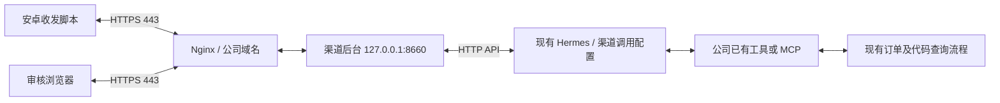

# 公司现有工具接入与 ECS 部署交接

更新：2026-10-28。公司已有供 Hermes 调用的查订单、查代码工具或 MCP；正式方案复用这些能力，**不新增本仓库的 8650 模拟 MCP 服务**。部署由使用方自行执行，个人 Mac 仅用于开发。

**交付状态：正式目标已明确，当前代码仍是模拟订单适配，尚不能直接停掉 8650 就接入现有工具。** 下文列出目标架构及需要完成的适配。原可复现的模拟环境命令移至 [模拟联调部署参考](模拟联调部署.md)，避免把联调步骤当作正式部署步骤。

整体原理及代码导航见 [技术方案](../docs/技术方案.md)，已验证结果见 [验收记录](../backend/VALIDATION.md)。本次文档修订未连接 ECS、修改运行配置或执行部署。

## 1. 正式服务范围

渠道后台与 Hermes 运行在 Ubuntu 22.04.5 ECS 宿主机；现有工具沿用原部署位置和调用方式。Hermes 已有 Docker 命令执行环境按公司现状保留。本项目需要新增部署的业务应用是渠道后台，域名由同机 Nginx 或经适配的公司网关接入。

| 入口或服务 | 正式用途 |
| --- | --- |
| 公司域名 HTTPS 443 | 手机接口与审核页面的共同入口 |
| 渠道后台 127.0.0.1:8660 | 一个 Python 服务，同时提供设备接口和审核页面/API |
| Hermes HTTP API | 沿用确认后的现有地址和端口；开发默认 8643，不代表 ECS 必须使用它 |
| 公司已有工具或 MCP | 沿用既有服务，不由本项目重复部署 |
| 本仓库模拟 MCP 8650 | 仅保留给开发联调，正式方案不新增 |

## 2. 为什么一个域名和端口可以共用

域名和端口把请求送到后台程序，程序再按 HTTP 方法和 URL 路径选择处理函数。示例域名 `https://channel-bot.example.com`：

| 请求 | 调用方 | 后台处理 |
| --- | --- | --- |
| `GET /` | 审核者浏览器 | 返回管理页面 |
| `GET /static/app.js` | 审核者浏览器 | 返回页面脚本 |
| `GET /api/review/list` | 审核页面 | 返回任务列表，校验审核凭证 |
| `POST /api/review/{task_id}` | 审核页面 | 提交审核决定，校验审核凭证 |
| `POST /api/messages` | 手机脚本 | 上报问题，校验设备凭证 |
| `GET /api/outbox` | 手机脚本 | 取本设备发件记录，校验设备凭证 |

只有一个后台程序监听 8660。Nginx 把这些路径转发给同一服务，浏览器访问首页和手机调用接口可以同时进行；共用端口本身不会造成端口冲突，也不会让设备凭证获得审核权限。审核页面与审核 API 同源，当前结构无须另开前端端口或配置跨域访问。

这是通信入口设计，不是无限并发能力承诺。当前 worker 仍串行调用智能体，部署初期继续使用单后台实例。

## 3. 当前代码与正式目标的差距

| 位置 | 现有实现 | 正式适配要求 |
| --- | --- | --- |
| [configure.py](../backend/configure.py) | 创建模拟 profile、8650 地址和模拟工具凭证 | 使用公司确认的 Hermes 调用配置及现有工具，初始化不覆盖公司 profile |
| [agent.py](../backend/channel_backend/agent.py) | 工具白名单固定 query_order/query_trace，指令只接受单订单结果 | 根据实际工具定义调整白名单、任务指令和结果解析，支持批准范围内的订单/代码查询 |
| [verify_profile.py](../backend/scripts/verify_profile.py) | 核验模拟 profile 的实际工具集合 | 核验正式允许集合及对应运行配置，保留配置变化检查 |
| [grounding.py](../backend/channel_backend/grounding.py) | 强制模拟标记、本地审计编号和订单字段 | 按既有工具返回定义依据校验和草稿格式，不能把任意结果误标为已核验 |
| [server.py](../backend/channel_backend/server.py) / 数据读取 | 读取本地模拟业务审计展示依据 | 将公司工具可提供的依据映射到审核详情 |
| [settings.py](../backend/channel_backend/settings.py) | 配置包含模拟业务凭证等必填项 | 区分现有工具接入与模拟模式的实际配置需求 |
| [后台服务模板](wechat-channel-backend.service) | Wants/After 依赖模拟业务服务 | 适配完成后移除这项依赖，只管理渠道后台 |

现有结果校验还要求 `mock=true`，并从本机 `audit.sqlite3` 找到本次两项工具审计。因此，不部署 8650、只改 Hermes URL 或工具名称，都不足以完成正式接入。不能为了让服务启动而直接关掉全部核验。

手机持久队列、设备接口、人工审批、发件状态和 HTTPS 入口可继续使用。订单与代码回答如何提供可核对依据，需要根据公司实际工具契约补齐；当前代码尚不支持代码查询答案。

## 4. 部署人员需要确认的信息

这些内容由公司维护者核对和保存，无须向开发助手提供服务器权限或密钥。

- Hermes 版本、HTTP API 地址和鉴权、用于群任务的 profile/调用配置；开发实测 v0.22.5，其他版本要核对 Runs、会话、取消及幂等能力。
- 已有工具的准确名称、参数结构、返回样例、错误和权限语义；工具通过哪个现有 MCP 或内置机制提供。
- 订单查询的渠道归属、允许字段和时间；代码查询的允许仓库、版本信息及可供审核的来源位置。
- 实际结果能否提供本次调用的可追踪依据；由此确定正式草稿校验，不假定存在模拟环境的审计编号。
- 域名、HTTPS 证书与手机信任链，办公网络访问范围，ECS 的运行账户和数据目录。

可以使用脱敏工具定义和样例完成适配设计，不需要复制真实密钥或完整业务数据库。

## 5. 适配与部署顺序

1. 固定现有工具契约，明确订单及代码两类问题的可核对依据和草稿形式。保持逐条人工审核，当前回群答案仍限 500 字符；更长结果需要另行设计呈现方式。
2. 完成上一节代码与配置适配，保留模拟模式供回归。验证正常结果、无权限、失败、缺依据、错误版本和不支持的问题，不能把失败文字作为正常答案批准入箱。
3. 生成不依赖模拟业务服务的宿主机后台服务配置；保留公司现有 Hermes 与工具的维护方式。检查 HTTP API 和实际工具集合后，再启动渠道后台。
4. 配置 HTTPS 域名转发到本机 8660，检查审核登录及一条网页问题的现有工具调用。网页来源始终不能被手机领取。
5. 为目标服务器生成独立设备配置，通过维护电脑 USB 写入已停止的测试手机；旧后台待办先核对，新旧队列分别保留。
6. 拔 USB 后在测试1完成真 @ → 完整问题 → 现有工具查询 → 人工审核 → 接收端确认；随后验证断网和重启恢复，记录不确定发送的处理。

在正式适配和目标环境验收完成前，保持当前单群、单审核人及每轮 30 分钟/10 条限制。公司服务器部署、运行验证由使用方执行。

## 6. 已有交付文件如何使用

- [Nginx 模板](nginx.conf.example)：页面和设备 API 共用域名的代理结构可复用；替换域名、证书，核对实际网关拓扑及 Host/Origin 校验。
- [环境检查脚本](../backend/scripts/check_host.py)：只读检查默认端口和版本；其中检查 8650 仅是旧联调诊断项，正式环境无需因此启动服务。
- [设备配置导出](../backend/scripts/export_phone_config.py)、[手机配置工具](../backend/scripts/provision_phone.py)：基于适配完成后的目标配置使用，仍只传设备凭证。
- `wechat-channel-business.service`：模拟环境专用，正式方案不安装。
- `wechat-channel-backend.service`：当前仍含模拟服务依赖，正式配置需按第 3 节调整，不能原样作为完成适配的证明。
- `configure.py`、`manage.py`：当前仍用于模拟环境初始化和本机联调，不用来接管公司已有 Hermes。

代码及数据目录继续建议使用 `/opt/wechat-android-poc/backend` 和 `/var/lib/wechat-channel`，由选定运行账户持有。后台使用 Python >=3.11 和仓库锁定依赖，依赖准备命令为 `uv sync --frozen --python 3.12`。

## 7. 验收、备份和回退

正式验收记录应包含版本、工具配置、任务编号、审批版本、发件结果和接收端确认。分别验证订单、代码问题，以及未审批不发群、设备凭证不能审批、网页模拟不能发群、故障不意外补发。

备份本项目的任务、审核、发件数据库和必要配置；Hermes 与既有工具按公司原有策略备份。维护前先停止手机并核对未完成投递；数据库备份使用一致方式，运行中不能只复制 SQLite 主文件而忽略 WAL。

回退时停止本项目后台，核对实际已发消息和手机队列，再恢复兼容版本；不要直接恢复旧快照后重发。既有工具/MCP 和公司其他 Hermes 用途继续按原维护边界管理。
