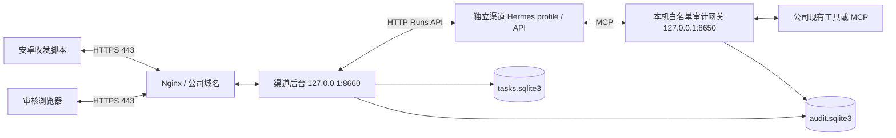

# 公司现有工具接入与 ECS 部署交接

更新：2026-10-28，公司补丁及代码审查修复。部署由使用方在 ECS 自行执行；本次只还原、审查和测试代码，没有切换个人 Mac 的运行配置或连接公司服务。

当前支持 `mock` 和 `live` 两种模式。`live` 复用公司已有代码图谱、语雀、订单/链路 MCP，在它们前面增加本项目的白名单与审计网关。**此实现仍需要本机 8650 服务；它在 live 模式转发真实工具，不再提供模拟订单。** 此前讨论的“Hermes 直接连接公司 MCP、完全取消 8650”是另一种架构，本次补丁没有实现。

技术全貌见 [技术方案](../docs/技术方案.md)，测试范围见 [验收记录](../backend/VALIDATION.md)。模拟模式的初始化和宿主机基础步骤保留在 [模拟部署参考](模拟联调部署.md)。

## 1. 当前 live 架构与端口



| 服务 | 作用 |
| --- | --- |
| 公司域名 443 | 手机接口与审核页面的共同入口 |
| 后台 8660 | 页面、任务、审核、设备接口和发件箱，一个 Python 服务 |
| Hermes API | 当前配置默认 8643；HTTP API 和工具核验必须对应同一个独立渠道 profile |
| 审计网关 8650 | 只监听回环地址；转发允许的调用、检查参数、保存审计，不重建业务查询逻辑 |
| 公司既有 MCP | 保留现有部署和维护方式 |

同一域名按路径区分：浏览器 `GET /`，审核 `GET /api/review/list` / `POST /api/review/{task_id}`，手机 `POST /api/messages` / `GET /api/outbox`。设备与审核凭证独立，不需要另外启动前端端口或开放 8643/8650 给手机。

Ubuntu 22.04.5 上后台与网关运行在宿主机；Hermes 保留宿主机安装，不改公司原来的 Docker 命令执行配置。当前渠道 profile 仍禁用终端、Skills、记忆和非白名单工具；不会自动继承其他 Hermes session 的能力。每个问题使用独立 session，连续对话仍未实现。

## 2. 本次适配的工具契约

| 类型 | 网关工具 | 上游方式 |
| --- | --- | --- |
| 代码图谱 | `code_list_services`、`code_list_domains`、`code_domain_nodes`、`code_find_nodes`、`code_entrypoints`、`code_graph_path`、`code_affected`、`code_mqflow` | `phgraph` Streamable HTTP + Bearer |
| 文档 | `doc_search`、`doc_get` | `yuque` stdio MCP，分别映射 search_doc / get_doc |
| 订单、链路 | `order_journey`、`order_by_jp`、`order_trace` | `aitool` SSE MCP；内部 execute_tool 只能调用 query_journey / query_order_jpnum / trace_grab |

13 个工具可按需开放，不会自动全部启用。`order_trace` 环境固定为 `pro`；不能从问题中改为其他环境，也不向模型开放通用 execute_tool。订单号格式为 6–64 个字母、数字、下划线或连字符；公司格式不同应先修改契约并补样例测试。代码工具限定参数类型、长度和查询深度；**尚没有服务/仓库级授权名单**。

语雀必须设置 `doc_books`（group_login/book_slug）。搜索只保留允许知识库的 HTTPS yuque.com 或子域 URL，无法识别的结果结构直接拒绝；读取必须在同一名单中。搜索支持结果数组和 data/results/items 包装，最多三层；不同实际契约需要适配，不能跳过过滤。

**权限边界：`channel_id` 在 live 模式只用于本地审计归属，不会自动传给现有订单 MCP，也不证明订单属于提问者渠道。** 上游需提供已经限制渠道/数据范围的凭证或适配服务；如果现有凭证能查全公司订单，当前网关不具备额外的归属校验，不能直接面向外部渠道启用该订单能力。文档白名单也不替代上游自身的访问控制。部署人员应按实际授权选择工具，先在内部测试群验收。

上游 `isError` 会按失败处理；若 execute_tool 在成功 MCP 包装内另用业务错误码表示失败，需按真实返回契约补齐映射。本次本地回归使用替身上游，未验证公司服务的错误语义或只读属性，尤其需要确认 trace_grab 的实际副作用。

## 3. 草稿与审核有什么变化

mock 继续按模拟订单字段拼接答案。live 由 Hermes 返回 `answer_draft.v1`（answer + audit_ids），模型草稿限 400 字符，人工审核后的回群文本仍限 500 字符。

后台检查工具白名单、调用参数、审计时间/归属，以及引用是否来自本轮成功结果，并运行部分敏感格式检查。**它不自动验证自由文本的全部事实、因果关系、时限承诺或个人信息**；审核人需要对照原始工具结果核对后再通过。失败调用不会作为成功依据，未审批不会进入发件箱。

每次成功结果最多保留 6000 字符，截断标志同时写入审计和展示在页面；详情默认预览 1500 字符，可展开查看已保存记录。截断后的记录不是完整上游结果，缺失内容需另查。上游报错和过滤失败的原始正文不会返回模型或保存为业务依据。

## 4. 配置与启用顺序

1. 先停止手机任务并核对未完成发件；在后台结束或人工处理未完成的智能体任务。停止本项目后台、网关及**专用渠道** Hermes API，避免用新工具处理旧任务。不要停止公司其他共享会话。
2. 准备代码及依赖：在 backend 目录运行 `uv sync --frozen --python 3.12`。首次安装先按基础部署参考创建全新、独立的 channel-bot profile 和 settings；`configure.py` 目前仅支持已核验的 DeepSeek 初始化，不要覆盖公司已有 profile，也不要复制个人 Mac 凭证。
3. 将上游配置保存为仅运行用户可读的文件，参考下方结构。只填写启用工具需要的上游；密钥使用公司配置管理，不提交 Git。
4. 运行 configure_live，重启审计网关及专用 Hermes API，执行 `scripts.verify_profile`，通过后才启动后台。此脚本核验实际工具集合，不代替真实业务查询验收。
5. 配置 HTTPS 域名转发到 8660；使用网页模拟提问验证真实查询、拒绝、错误和审核。网页任务仍不能被手机领取。
6. 通过维护电脑将独立目标配置写入已停止的手机，拔 USB 后完成真 @ → 实际工具 → 人工审核 → 收件确认；再验证断网、重启和长期运行。

上游配置结构（全部为占位，stdio 的命令、包版本、参数、环境变量名需按已安装的公司 MCP 填写）：

```json
{
  "phgraph": {"url": "https://code-tools.example.com/mcp", "token": "REPLACE_ME"},
  "aitool": {"url": "https://order-tools.example.com/sse"},
  "yuque": {"command": "/absolute/path/to/yuque-mcp", "args": [], "env": {"YUQUE_TOKEN": "REPLACE_ME"}}
}
```

当前 aitool 客户端只配置 SSE URL，没有通用认证头配置；如公司端点要求认证头，应先适配，不要将凭证写进文档示例。语雀进程继承服务器用户可用环境，请使用专用运行账户和固定的已安装命令。

以下命令以已经完成基础初始化、全部渠道服务停止为前提：

```sh
cd /opt/wechat-android-poc/backend
CHANNEL_DATA_DIR=/var/lib/wechat-channel .venv/bin/python -m scripts.configure_live   --upstreams /private/path/upstreams.json   --tools code_list_services,code_list_domains,code_domain_nodes,doc_search,doc_get   --doc-books team/channel-faq
# 按公司维护方式启动网关及专用 Hermes API 后：
CHANNEL_DATA_DIR=/var/lib/wechat-channel .venv/bin/python -m scripts.verify_profile
# 核验通过后再启动渠道后台。
```

默认 live 最多 16 轮、300 秒；可用 `--max-turns`（1–30）、`--run-timeout`（30–900 秒）调整。它们是调用上限，不是响应时效承诺；每条发件仍受 30 分钟有效期约束。

配置工具会校验完整输入、检查后台进程锁，完整备份被替换的 settings/upstreams/config/SOUL 和已有核验凭据，再以 0600 原子替换单个文件。备份名含唯一 before-live 后缀。普通写入失败会恢复原文件；核验凭据保持失效，必须重新核验。多文件更新不是断电事务：进程被强杀或断电后需检查备份并恢复一致配置，不能直接启动。脚本只检测后台锁，网关和专用 Hermes 的停机由维护者负责。

## 5. 运维文件与回退

- `wechat-channel-business.service` 现在同时适用 mock 服务和 live 网关；backend 模板仍依赖它，**live 不能移除该依赖**。替换运行用户和目录后再启用。
- stdio 语雀进程在 business 服务内运行，受其 ProtectSystem/ProtectHome/ReadWritePaths 限制。预先安装依赖，核对其所需缓存/临时目录；按实际需求增加最小可写路径，不在启动时临时下载包。
- `nginx.conf.example`、设备配置导出/写入工具继续适用；只为手机配置设备凭证。`manage.py` 是 Mac 联调工具，不接管公司 Hermes。
- 数据默认在 `CHANNEL_DATA_DIR`：tasks.sqlite3 保存问题、审核、事件和发件；audit.sqlite3 保存工具审计。上游凭证文件和备份也在私有目录，按敏感数据管理。运行中备份 SQLite 应使用一致方式，不只复制主文件而忽略 WAL。
- 回到模拟模式：按同样停机步骤运行 `CHANNEL_DATA_DIR=... .venv/bin/python -m scripts.configure_live --mock`，重启网关/渠道 Hermes、重新核验、再启动后台。它会生成标准模拟配置，**不是逐字还原旧配置**；要精确回退需按同一 before-live 后缀恢复全部备份，并删除旧核验凭据后重新核验。
- 核对手机队列和已发送结果后再恢复工作；不要恢复旧数据库后直接重发。保持单群、单设备、逐条人工审核及每轮 30 分钟/10 条限制，直到目标环境验收完成。
