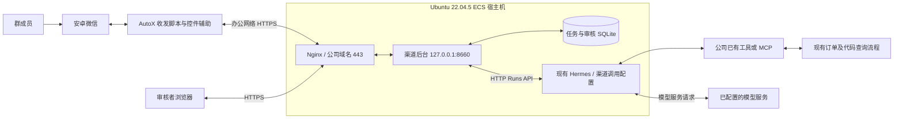
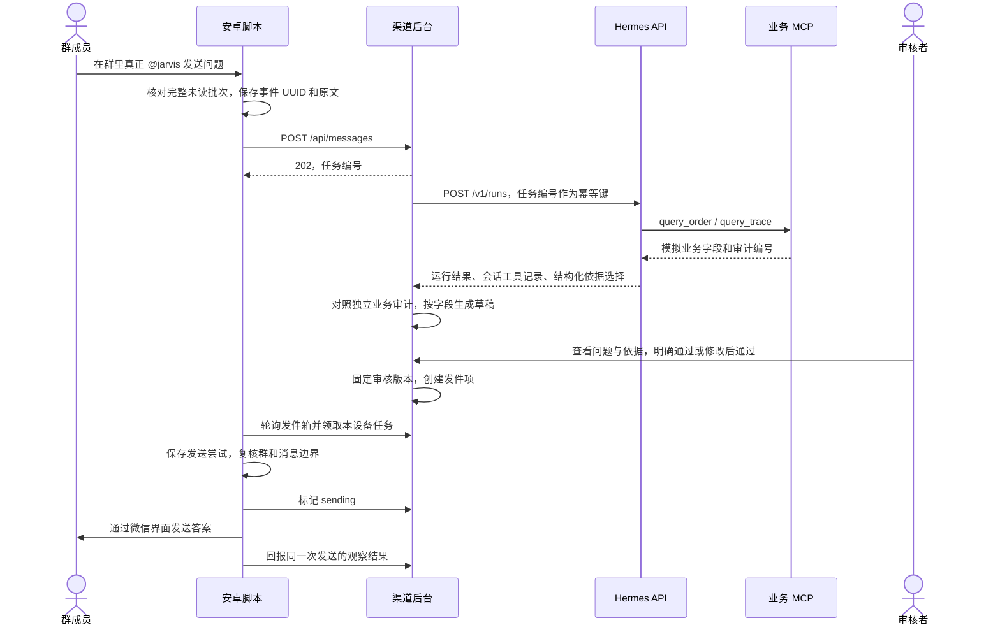
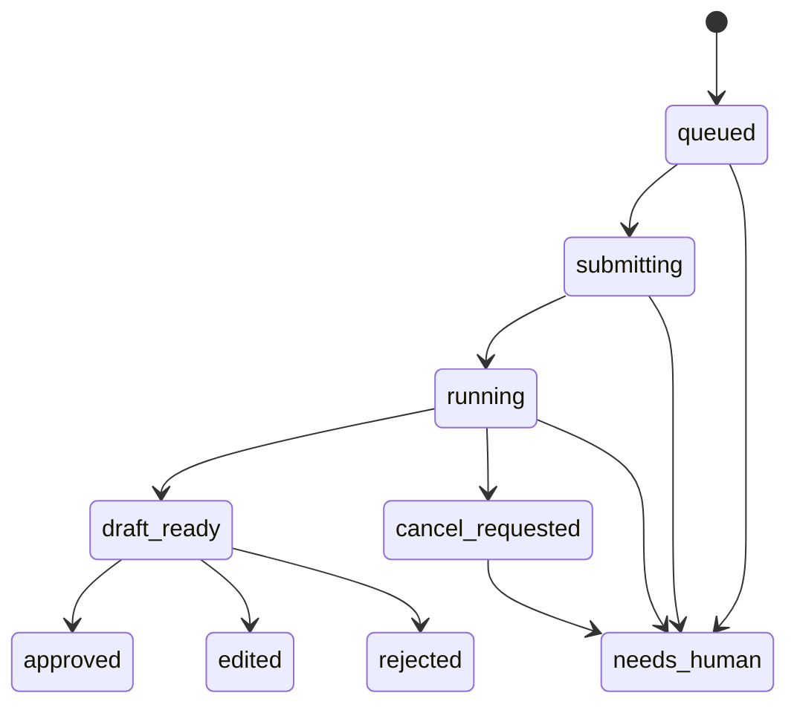
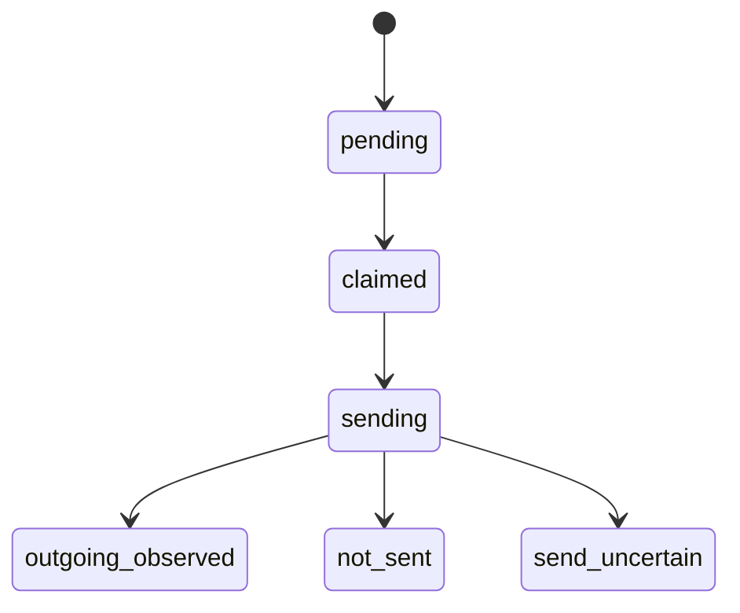

# 渠道微信群智能体技术方案

文档日期：2026-10-28。实现基线：`7380ccb` 及本次文档提交。本文区分仓库当前模拟实现与公司正式接入目标；部署交接见 [ECS 部署交接](../deploy/README.md)，实际验证记录见 [后端验收记录](../backend/VALIDATION.md)。

原《渠道群智能体接入方案.md》包含早期设计和未来自研智能体规划。本文补齐目前已实现的系统全貌，并区分代码能力、实测结论和后续工作；原方案中的未来能力不能作为当前交付能力。

2026-10-28 补充确认：公司已有查订单、查代码工具或 MCP，正式接入复用这些能力，不新增本仓库的 8650 模拟服务。当前适配器仍绑定模拟契约，正式代码适配尚未完成。

## 1. 目标和交付范围

在指定微信群中识别用户真正 @ 机器人的文字问题，交给 Hermes 查询业务依据，由人工核对答案后，再由安卓手机发回原群。首轮用于验证消息、智能体、审核和投递的闭环。

当前使用 `测试1` 群、机器人昵称 `jarvis`、单设备和模拟订单/流程数据。固定回执模式仍保留，与智能体模式分别启动。智能体模式没有自动审批。

| 能力 | 当前状态 |
| --- | --- |
| 小米真实 @ → 完整问题上报 → Hermes 模拟查询 → 人工审核 → 微信收件 | 已在 Mac＋USB 模式实测 |
| 摘要截断时读取群内完整正文、依据校验、列表审核页面 | 已实现并验证，受下文边界约束 |
| HTTPS 地址、设备配置导出、不同后台队列隔离 | 已实现并通过自动化回归；安卓真机 HTTPS 待验 |
| Ubuntu 22.04.5 宿主机部署 | 已提供模拟模板与正式适配交接；未在目标 ECS 安装或验证 |
| 公司已有订单/代码工具接入 | 目标已确认，当前工具白名单、结果校验和服务依赖待适配 |
| 真实订单/知识库、多人审核、多群、全天运行 | 未实现或未完成对应验收 |

部署由项目使用方自行执行。个人 Mac 是开发和现有联调环境；公司部署及手机网络验收通过后，日常运行依赖手机和 ECS，无须持续连接这台 Mac。首次更新手机脚本和配置仍通过维护电脑 USB 完成。

## 2. 系统架构

### 2.1 公司正式接入目标（复用现有工具）



渠道后台与 Hermes 运行在宿主机；公司已有工具沿用现有部署位置和调用方式，不新增本仓库的 8650 模拟服务。Hermes 的 API 地址和端口沿用经确认的配置，8643 是开发默认值。公司已有 Docker 命令执行环境不在本次改动范围。

入口域名和证书尚待申请。手机与审核浏览器仅访问渠道后台域名，由同机 Nginx 转到 8660；它们不直接调用 Hermes 或业务工具。公司统一网关如采用不同代理链，需要相应核对 Host/Origin 与 HTTPS 配置。

正式调用要明确允许的现有工具及其权限和依据，不应照搬模拟环境的两个工具名称。当前 `configure.py`、预检、业务审计读取、字段草稿及 systemd 依赖仍绑定模拟 MCP，必须适配后才能运行该目标架构。详细差距见 [正式接入交接](../deploy/README.md)。

### 2.2 当前 Mac 联调拓扑

安卓脚本访问 `http://127.0.0.1:8660`，由 `adb reverse` 转到 Mac 后台。Mac 上的后台、Hermes、模拟业务服务分别使用 8660、8643、8650 端口。因此当前智能体联调需要 USB 与 Mac 在线；固定回执模式独立在手机运行。

HTTPS 是已准备的下一种传输方式，尚未替换当前手机配置。部署服务器时新建独立配置和数据库，旧 Mac 任务不会自动迁移。

### 2.3 当前实现的技术栈与职责

| 组件 | 技术 | 职责 |
| --- | --- | --- |
| 手机执行器 | AutoX.js 7.2.4、JavaScript、Android 无障碍 | 读取可见控件、判断消息归属、持久化问题、领取及发送答案 |
| 微信控件辅助 | Android Java 辅助服务 | 配合微信控件暴露，维持正常单击；不负责调用模型 |
| 渠道后台 | Python >=3.11、aiohttp、SQLite | 设备鉴权、任务队列、Hermes 适配、审核、发件协议 |
| 审核前端 | 原生 HTML/CSS/JavaScript | 列表、筛选、分页、依据详情、人工审核；无需前端构建服务 |
| 智能体 | 独立 Hermes profile、HTTP API | 理解单订单问题、调用允许的业务工具、选择本次依据 |
| 模拟业务工具 | MCP SDK、Python、SQLite 审计 | 当前开发环境的订单/流程样例；正式环境复用公司已有工具 |
| 宿主机运维 | systemd、Nginx | 当前模板包含后台与模拟服务；正式方案只新增渠道后台，适配后移除模拟依赖 |

没有独立 Redis、消息中间件或分布式任务系统。后台在单进程中串行处理任务；当前设计面向受控小规模试点，不支持多实例横向扩容。

### 2.4 一个域名承载页面和手机接口

一个 Python 后台监听 8660，同时注册页面和接口路由。Nginx 在 443 收到请求后保持路径转发，后台按 HTTP 方法和路径处理：

| 路径（同一域名） | 用途 | 凭证 |
| --- | --- | --- |
| `GET /`、`GET /static/app.js` | 审核页面及资源 | 页面可加载，业务数据另需鉴权 |
| `GET /api/review/list`、`POST /api/review/{task_id}` | 查询和审核任务 | 审核凭证 |
| `POST /api/messages`、`GET /api/outbox` | 手机上报和领取答案 | 设备凭证 |

例如浏览器访问 `https://channel-bot.example.com/`，手机访问 `https://channel-bot.example.com/api/messages`。这是同一服务提供不同功能，不是两个程序抢占同一个端口。可以同时访问；权限按接口独立校验，共用域名不会使设备获得审核权限。页面与审核 API 同源，无须为此拆成两个域名或端口。

## 3. 当前模拟实现的一次问答如何流转

以下时序保留当前已验证的模拟工具与审计格式。正式环境仍沿用收发、任务和人工审核流程，业务工具及依据部分按公司现有契约适配，不能原样假定已支持查代码。



手机收到问题后立即持久化并异步上报，不等待模型返回，也不先发固定回执。审批可以稍后进行，但受任务和发件有效期约束。手机停止时不会继续领取或发送答案。

网页“模拟提问”走同一智能体与审核流程，但任务来源为 `web-demo`。其发件记录只供后台验证，设备凭证不能领取；不会因此发到微信群。

## 4. 手机消息识别与发送

### 4.1 识别真正 @ 的依据

微信没有向本项目提供结构化消息接口。脚本读取会话列表的 `[有人@我]` 标记，再结合群内可见控件判断这一批未读中是哪条问题。该标记属于整个会话，不等于每条消息都有可靠的 mention 元数据。

当前放行条件：

1. 手机解锁，微信聊天列表可见，目标群名称唯一且可见；启动时先在未读为 0 时建立消息边界。
2. 列表出现真正 @ 标记，未读数在 1–5 之间。
3. 进入群后找回唯一旧边界；新增消息数量与未读数一致，整批均为完整可见的收到的文字。
4. 整批只有一个 @，目标昵称与问题格式匹配，提问人可读。
5. 最后一条消息与列表摘要一致；若是已适配的省略号截断，则要求发言人一致、有效正文前缀匹配，完整问题仍从群内读取。

多条 @、真实 @ 混合粘贴 @、图片或系统消息、跨屏正文、边界不明等情况会暂停待检查。没有真正 @ 标记的粘贴文字和普通消息不会触发。不会根据截断摘要猜测缺失正文。

### 4.2 消息身份

手机生成本地回执、事件 UUID 和观测时间；后端用设备身份与事件 UUID 去重。重试沿用原 UUID 和原文；相同 UUID 的不同正文返回冲突。用户重新发送相同普通问题会产生新的事件，而不是按文字内容去重。

这些编号是项目自己的消息身份，不是微信消息 ID。提问人是界面显示名，不能作为可靠的微信账号 ID 或业务授权凭据。固定 `测试NNN` 命令沿用旧编号去重机制。

### 4.3 投递条件

手机只领取本设备、本群、且私有队列认识的任务。点击发送前再次检查群标题、未读数、原消息边界、输入框和待发文字。输入框有人工草稿、新消息改变边界、已有相同答案气泡时停止；不覆盖人工输入，不盲目补发。

长答案造成输入框变高时，最多进行限定次数的滚动复核；仍无法确认消息末尾则不点击。所有微信操作由同一监听引擎串行完成。

每次面板启动最多 30 分钟、10 条回复。锁屏、离开微信列表或辅助服务失效时进入等待或停止状态，按面板提示人工恢复。现有华为恢复测试不能直接作为小米智能体版本的长期稳定性证明。

## 5. 当前模拟适配器的 Hermes 接入与业务依据

### 5.1 接口与运行隔离

后端通过 Hermes HTTP API 提交运行、查询进度、获取事件、停止超时运行，并读取该任务会话的实际工具记录。手机和浏览器均不直接调用 Hermes。

开发环境实测 Hermes v0.22.5，提交 `bf0203a794a0`。ECS 版本和 API 状态待部署人员确认；本文不保证任意版本兼容，也不要求覆盖公司已有默认配置。

专用 `channel-bot` profile 的实际工具仅允许：

- `mcp__biz__query_order`：查询订单当前状态、环节和资料要求。
- `mcp__biz__query_trace`：查询对应流程节点。

每个任务使用独立会话，`session_id = task_id`；提交使用同一个任务编号作为 `Idempotency-Key`。当前并发为 1，配置最多 6 个智能体轮次。未开启跨问题记忆或连续对话。

`verify_profile.py` 检查实际运行时工具集合，生成配置指纹报告。后台预检报告、profile 配置和 API 能力；不匹配时不提交新任务。不能只看 `/v1/toolsets`，因为已验版本该接口未完整列出 MCP 工具。

### 5.2 业务权限与模拟数据

MCP 服务从自己的服务端凭证绑定渠道 `demo-channel-a`，不接受用户在问题里指定授权渠道。查询前核对订单归属；不存在与无权访问使用相同拒绝结果。

当前样例包括 A123 待补资料、A124 已完成、B999 其他渠道、Z000 不存在、A500 工具错误、A408 超时错误样本。它们都是模拟数据，不连接公司订单系统。

模型服务为当前配置的 DeepSeek。初始化脚本仅支持已适配的 DeepSeek 设置；若更换模型供应商，需要调整配置接入并重新验证，不是只填写任意模型名称。

### 5.3 草稿不是直接转发模型自由文本

Hermes 完成工具查询后应返回严格结构化结果：

```json
{
  "schema": "order_facts.v1",
  "order_id": "A123",
  "order_audit_id": "audit_<本次订单查询编号>",
  "trace_audit_id": "audit_<本次流程查询编号>"
}
```

上述审计编号为格式示意。无法处理时返回 `needs_human.v1`，原因限定为缺订单号、多订单、工具失败或超范围。

后台将实际工具调用与独立业务审计关联，再检查：订单是否与问题一致，两个依据是否来自本次运行和允许的工具，数据是否完整，快照时间、当前环节、状态及流程末节点是否相互一致。额外自由文本、伪造依据和矛盾结果不能生成可审核草稿。

通过后由 `grounding.py` 按业务字段拼出中文草稿，标记“模拟数据”；未核实原因与时限明确说明“具体原因与处理时限：本轮未核实，请人工确认。”审核者仍须核对最终文字，尤其是人工改写的内容。

这是单订单模拟查询契约。复用公司现有订单/代码工具或以后接知识库时，必须更新调用适配、权限、结果契约和依据校验；业务查询能力复用既有流程，不重新建设 8650 服务，也不能仅替换 URL 或删除“模拟数据”标识。

## 6. 后端接口

接口入口是渠道后台的同一个域名。业务接口使用 `Authorization: Bearer <对应凭证>`，JSON 请求使用 `Content-Type: application/json`。设备、审核、Hermes、业务工具凭证分别生成。

| 接口 | 角色 | 作用 |
| --- | --- | --- |
| `GET /health` | 无凭证 | 服务和 worker 状态、当前传输模式；不是完整业务就绪证明 |
| `GET /api/device-info` | 设备 | 核对后台、设备和群的身份 |
| `POST /api/messages` | 设备 | 接收问题，返回任务编号和是否新建 |
| `GET /api/outbox` | 设备 | 查询本设备最近 100 条发件记录，不返回领取凭证 |
| `POST /api/outbox/{id}/claim` | 设备 | 领取待发项，获得 60 秒租约 |
| `POST /api/outbox/{id}/sending` | 设备 | 登记同一次发送尝试 |
| `POST /api/outbox/{id}/ack` | 设备 | 提交结果与观察依据 |
| `POST /api/demo/messages` | 审核 | 创建网页模拟任务 |
| `GET /api/review/list` | 审核 | 数据库分页、分类统计和筛选 |
| `GET /api/review/task/{task_id}` | 审核 | 完整问题、草稿、依据和投递详情 |
| `POST /api/review/{task_id}` | 审核 | 按版本通过或驳回 |

旧 `GET /api/review/tasks` 保留用于兼容诊断，仅返回最近 100 条；新版页面使用分页接口。

设备问题示例（示意编号）：

```json
{
  "event_id": "11111111-1111-4111-8111-111111111111",
  "group_ref": "test-1",
  "group_name": "测试1",
  "sender_display_name": "测试成员",
  "content": "订单 A123 卡在哪一步？",
  "observed_at": "2026-10-28T10:00:00+08:00",
  "local_receipt_id": "text-1"
}
```

必填为事件、群引用、群名、正文和带时区的时间；显示名和本地回执为可选字段。问题长度为 1–1000 字符，审核答案为 1–500 字符。群范围由服务端配置约束，不能靠请求自行切换。

审核请求为 `{"decision":"approve","text":"审核后的答案","version":1}`，或 `decision=reject`。重复提交同一决定、文字和版本幂等返回；改变已审核结果返回 409。当前没有撤销审批和重新编辑已入箱答案的功能。

`claim` 发送空对象；`sending` 携带 `lease_token`、`attempt_id`；`ack` 还携带 `outcome` 和 `evidence`。设备必须遵循整个状态协议，不能直接拿到答案就发群。

## 7. 数据与状态

### 7.1 存储

| 位置 | 内容 | 保留与用途 |
| --- | --- | --- |
| 数据目录 `tasks.sqlite3` | tasks、events、reviews、outbox | 问题、运行事件、人工决定、最终发件版本和结果 |
| 数据目录 `audit.sqlite3` | 业务查询审计 | MCP 写入，后台按渠道和工具记录核对 |
| 数据目录配置与核验报告 | settings.json、reviewer-key.txt、profile-verification.json | 凭证、连接配置和工具核验；不得进入 Git |
| 独立 Hermes profile | 配置、凭证、运行与会话数据 | 与默认个人/公司助手配置隔离 |
| 手机 AutoX 私有目录 | 配置、问题与投递队列 | 保存原事件、租约、尝试编号和回报状态 |
| 手机项目 artifacts | 监听状态、去重边界、诊断日志 | 可能包含聊天原文，不属于可公开代码 |

默认数据目录为 `backend/.local`；ECS 模板通过 `CHANNEL_DATA_DIR=/var/lib/wechat-channel` 指定。SQLite 使用 WAL 与事务，审核决定和发件项在一个事务内写入。

网络模式的手机队列按 `backendId` 分文件保存；旧 USB 配置兼容原队列。切换后台要求机器人停止、显式确认切换且不存在阻止迁移的未完成本地工作，旧配置和队列保留。服务器旧任务不会随配置自动搬迁。

### 7.2 任务状态



`approved` 表示原文通过，`edited` 表示修改后通过，两者创建发件项；`rejected` 不发件。`needs_human` 是待人工处理的异常，不会自动生成一个可通过的答案。界面“已过期”由时间和状态计算，不是额外的数据库任务状态。

### 7.3 发件状态和保证范围



领取未进入发送时，服务端协议允许到期后重新领取；当前手机不会自动接管不明领取或重投不确定发送。进入 `sending` 后不因租约到期回收。发送前先在手机落盘阶段信息；进程中断后按原尝试核查或回报，不再点击同一条答案。

- `outgoing_observed`：手机观察到相应右侧气泡；不证明微信服务端投递成功或对方已读。
- `not_sent`：该次尝试确认未点击发送；当前不提供自动重投。
- `send_uncertain`：点击阶段中断或结果无法确认，需要人工核查。

本方案追求可追溯、重复上报幂等及避免不确定重发；受微信 UI 观察限制，不能承诺消息绝不丢失、绝不重复或端到端恰好一次送达。

## 8. 审核工作台

页面提供答案审核与发件记录两个列表，支持来源、群聊、时间和关键词组合筛选，按最新/最早排序，每页 10/20/50 条。列表由数据库分页，详情按需读取依据，避免一次加载全部审计内容。

详情展示完整问题、订单和流程依据、原始审计记录、草稿及最终发送状态。审核者逐条通过、修改后通过或驳回；发件记录展示审核确定的版本。

列表每 5 秒更新。在同一页面内，编辑内容不会被刷新或关闭详情覆盖；重新加载整个页面会丢失尚未提交的修改。任务实时增加可能移动翻页边界，当前不是冻结数据快照。

目前只有一个审核凭证和固定审核者标识，没有员工账号、分角色审批、多人责任追踪、批量审批或企业 SSO。配置应按单审核人试点使用。

## 9. 超时、故障与恢复

| 场景 | 当前处理 |
| --- | --- |
| 手机上报失败 | 保存原事件与正文，网络恢复后重试；不新建 UUID |
| Hermes 提交结果不明 | 保存原请求；在 5 分钟恢复窗口内沿用同一幂等键，单次处理最多提交 3 次；超过窗口转人工 |
| 已获得 Hermes run_id | 只查询或停止原运行，不重新创建运行 |
| 模型处理超过默认 180 秒 | 请求停止并等待最多约 30 秒；异常转人工，取消后的迟到答案不入箱 |
| 查询失败、无权限、依据不一致 | 转人工，不产生可审核草稿或发件项 |
| 问题/草稿过旧 | 任务创建超过 30 分钟后不能首次审批；待处理旧问题不再新跑 |
| 发件过旧 | 审批后 30 分钟未进入允许的发送流程，拒绝新领取/启动发送 |
| 已发气泡但回报失败 | 只重报原尝试结果，不重新点击发送 |
| 手机退出或重启 | 持久记录保留；按面板恢复检查，不能靠清空队列重新发送 |
| 后台重启 | 从 SQLite 中继续未完成任务；未完成提交沿用原请求与键，已知运行沿用原 run_id |
| 手机换后台 | 停止后验证新域名、凭证和后台身份，隔离新旧队列，不迁移旧待发任务 |

上述包括代码与自动化测试验证的规则，不表示每一种断点都已在小米、公司网络和真实模型组合下实测。实测范围以验收记录为准。

## 10. 部署与日常维护

操作入口为 [部署交接说明](../deploy/README.md)。正式目标采用单台 ECS 上的渠道后台、现有 Hermes 和本机任务 SQLite，查询复用公司已有工具或 MCP。当前模拟服务模板需先按交接说明完成适配。域名、证书、ECS Hermes 版本/API、运行用户及现有工具契约由部署人员核对。

手机只保存设备凭证，审核浏览器使用审核凭证，后台保存 Hermes 凭证。Hermes 按公司原有方式持有模型及现有工具的调用配置；模拟环境另用本项目生成的业务工具凭证。审核凭证在浏览器当前标签会话保存；不要把它放入仓库、聊天记录或公开链接。

网络模式要求 HTTPS DNS 域名，禁止跳过证书校验、自动重定向到其他地址或使用任意明文 IP 接口。后台校验精确 Host/Origin，只接受同机代理提供的 HTTPS 标记。凭证与数据库按受控文件保管，当前没有自动凭证轮换和数据归档服务。

日常查看手机面板、后台 `/health`、systemd 日志、任务“需关注”和发件结果。`/health` 返回运行不等于模型密钥、业务查询或微信群投递已经正常，必须通过完整模拟问题验收。当前未提供告警平台集成或可承诺的响应时间 SLA。

备份应覆盖后台数据目录和专用 Hermes profile；一致备份、回退和手机切换规则见部署说明。不要在运行中只复制 SQLite 主文件或恢复旧快照后直接重发。

## 11. 交付边界与后续阶段

当前已记录后端 44 项、手机端 107 项自动化测试通过，审核页用 127 条隔离记录验证分页和交互。相关记录是代码回归证据，不代表目标服务器容量或真实公司环境验收。

公司试点先完成：既有订单/代码工具契约与适配 → Hermes API 兼容性和实际工具核验 → HTTPS/审核页 → 网页提问及真实来源依据核对 → 小米拔 USB 实收实发 → 断网、重启与发送异常核对 → 受控延长运行观察。微信升级测试按当前安排暂不纳入这轮验收。

当前必须保留的限制：

- 单群、单手机、单审核人；每轮 30 分钟/10 条，手机需要解锁并保持微信列表可见。
- 未读 1–5 条且仅一个可归属 @；跨屏长文、媒体、忙碌群多条 @ 无法可靠处理。
- 同样文字的新问题可以入队，但屏幕内已有相同答案时仍可能停止发送，不能以重复问题一定可回复作为承诺。
- 手机私有问题队列上限 1000；设备发件查询最近 100 条，尚未提供长期归档与积压治理。
- 单订单模拟事实；没有真实数据、知识库、跨任务上下文或真正 @ 原提问人的回复能力。
- 小米智能体版本的办公网络、长时间运行和全部故障恢复尚待验收；不能沿用旧华为固定回执测试替代。

接公司现有工具时先确认调用接口、渠道/仓库权限、返回字段和时效，再适配工具白名单与草稿依据契约，并验证越权、缺字段、矛盾数据、超时及真实答案质量；不要求重建现有工具或 MCP。换自研智能体、影子对比、多群、SSO 或无人审核均属后续开发，不是修改配置即可获得的能力。

## 12. 代码导航

| 入口 | 主要内容 |
| --- | --- |
| [watch-test-group.js](../watch-test-group.js)、[mention-policy.js](../mention-policy.js) | 微信控件、未读边界、消息判断和投递复核 |
| [agent-bridge.js](../agent-bridge.js)、[agent-client.js](../agent-client.js) | 持久队列、投递状态、HTTP/HTTPS 与私有文件 |
| [phone-panel.js](../phone-panel.js)、[run-recovery.js](../run-recovery.js)、[setup-agent.js](../setup-agent.js) | 启停、恢复、后台切换 |
| [accessibility-helper](../accessibility-helper/) | 安卓控件辅助应用 |
| [server.py](../backend/channel_backend/server.py)、[network.py](../backend/channel_backend/network.py) | HTTP 接口、分权、域名与配置边界 |
| [store.py](../backend/channel_backend/store.py)、[review_query.py](../backend/channel_backend/review_query.py) | SQLite 事务、审核、发件和列表查询 |
| [agent.py](../backend/channel_backend/agent.py)、[grounding.py](../backend/channel_backend/grounding.py) | Hermes 适配、工具依据关联、字段草稿 |
| [business.py](../backend/channel_backend/business.py)、[mcp_server.py](../backend/channel_backend/mcp_server.py) | 模拟业务查询与独立审计 |
| [static](../backend/channel_backend/static/) | 审核页面 HTML、CSS、JavaScript |
| [configure.py](../backend/configure.py)、[verify_profile.py](../backend/scripts/verify_profile.py) | 首次配置与实际工具核验 |
| [export_phone_config.py](../backend/scripts/export_phone_config.py)、[provision_phone.py](../backend/scripts/provision_phone.py) | 设备配置导出与停止状态下的 USB 维护 |
| [部署目录](../deploy/)、[本机后端说明](../backend/README.md) | 公司部署交接和开发联调说明 |

`backend/manage.py` 管理本机联调的三个服务；公司 ECS 正式接入只新增渠道后台，Hermes 与现有工具沿用公司维护方式；当前模拟服务模板需要先适配，不直接照搬本机的一键启停。
